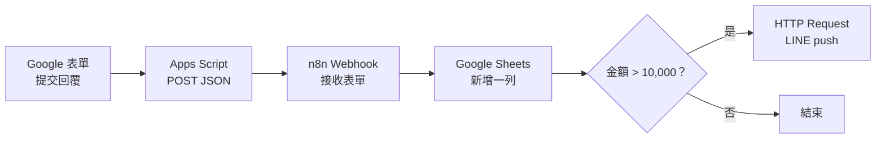

# Google 表單 → 試算表 → LINE 通知

這份範本把 Google 表單回覆送進 n8n，先新增到 Google 試算表，再依金額門檻決定是否推送 LINE 訊息。範本沒有任何可用的 token、帳號或文件 ID；所有 `<YOUR_...>` 都必須換成自己的設定。



## 已驗證版本

- n8n `1.123.85`
- 驗證方式：`n8n import:workflow --input=workflow.json`，可匯入且沒有錯誤。
- 工作流程預設停用；完成下列憑證與欄位設定後再啟用。

## 1. 匯入工作流程

1. 在 n8n 的 Workflows 頁面選「Import from File」。
2. 選擇 [`workflow.json`](./workflow.json)。
3. 開啟每個節點，依下一節完成設定。
4. 先使用 Webhook 的測試網址測試，確認後再啟用工作流程並改用正式網址。

## 2. 節點與憑證

### 接收表單（Webhook）

- 不需要憑證。
- 方法保持 `POST`，路徑預設為 `google-form-to-line`。
- 測試時按「Listen for test event」並複製測試網址；正式使用則先啟用工作流程，再複製 Production URL。

### 寫入試算表（Google Sheets）

1. 在 n8n 建立 Google Sheets OAuth2 憑證並完成 Google 登入。
2. 在節點重新選取這組憑證；匯入檔中的 `<YOUR_GOOGLE_SHEETS_CREDENTIAL_ID>` 與 `<YOUR_GOOGLE_SHEETS_CREDENTIAL_NAME>` 只是占位。
3. 將 `<YOUR_GOOGLE_SHEET_ID>` 換成試算表網址 `/d/` 與 `/edit` 中間的 ID。
4. 將 `<YOUR_SHEET_NAME>` 換成工作表分頁名稱，例如 `表單回覆`。
5. 第一列建立四個欄名，大小寫需一致：`submittedAt`、`name`、`amount`、`note`。

### 金額超過門檻？（IF）

- 不需要憑證。
- 預設門檻為 `10000`，判斷條件是 `amount > 10000`；可直接修改右側數字。
- `amount` 會先轉成數字，避免表單傳入字串時用文字方式比較。

### 推送 LINE 通知（HTTP Request）

1. 在 n8n 建立 **Header Auth** 憑證：
   - Name：`Authorization`
   - Value：`Bearer <YOUR_LINE_CHANNEL_ACCESS_TOKEN>`
2. 在節點重新選取這組憑證；匯入檔中的 `<YOUR_LINE_HEADER_AUTH_CREDENTIAL_ID>` 與 `<YOUR_LINE_HEADER_AUTH_CREDENTIAL_NAME>` 只是占位。
3. 在 JSON Body 把 `<YOUR_LINE_RECIPIENT_ID>` 換成接收者的 user ID、group ID 或 room ID。
4. 節點會以 `POST` 呼叫 `https://api.line.me/v2/bot/message/push`，並送出一則文字訊息。

LINE push 的接收者必須符合 LINE Messaging API 的傳送條件，例如使用者已將官方帳號加為好友。請勿把 Channel Access Token 直接寫進 workflow 或版本控制；只存進 n8n 憑證庫。

## 3. 設定 Google 表單 Apps Script

1. 建立三個題目，標題分別為「姓名」「金額」「備註」。其中「金額」建議加上數字驗證。
2. 在表單右上角選單開啟 Apps Script，把 [`apps-script.gs`](./apps-script.gs) 貼入專案。
3. 將 `<YOUR_N8N_WEBHOOK_URL>` 換成 n8n Webhook 的測試或正式網址。
4. 在 Apps Script 左側「觸發條件」新增觸發條件：
   - 要執行的函式：`onFormSubmit`
   - 活動來源：`來自表單`
   - 活動類型：`提交表單時`
5. 第一次建立觸發條件時，依畫面授權表單資料與外部 HTTP 請求。

不要在編輯器直接按「執行」測 `onFormSubmit`；手動執行沒有表單事件物件，程式會刻意報錯。

## 4. 測試

### 不經 Apps Script，先測 n8n

讓 Webhook 進入測試監聽後執行：

```bash
curl -X POST '<YOUR_N8N_WEBHOOK_URL>' \
  -H 'Content-Type: application/json' \
  -d '{
    "submittedAt": "2026-10-19T10:00:00.000Z",
    "name": "測試使用者",
    "amount": 12000,
    "note": "測試高於門檻"
  }'
```

確認：

1. 試算表多一列，四欄內容正確。
2. `12000` 大於預設門檻，IF 的 true 分支有執行。
3. LINE 收到一則通知。
4. 再用 `amount: 5000` 測一次：試算表仍會新增，但 LINE 不應收到通知。

最後提交一次真正的 Google 表單，確認 Apps Script 的「執行項目」顯示成功。

## 免費方案與配額限制

- **n8n**：n8n Cloud 提供有期限與執行次數上限的免費試用，並非永久免費方案。Community Edition 可自行架設，但伺服器、網域、HTTPS、更新與備份需自行負責，也受其 Sustainable Use License 限制。正式使用前查看 [n8n Pricing](https://n8n.io/pricing/) 與授權條款。
- **Google Apps Script**：`UrlFetchApp`、觸發條件總執行時間等都有每日配額；超過時腳本會停止並拋出例外。配額依帳號類型而異且可能調整，請查 [Apps Script quotas](https://developers.google.com/apps-script/guides/services/quotas)。
- **LINE Messaging API**：可發送量與費用依官方帳號所在地及方案而異；push 對象也必須符合官方限制。上線前在 LINE Official Account Manager 確認當月訊息用量，並查 [Send messages](https://developers.line.biz/en/docs/messaging-api/sending-messages/)。
- Webhook 必須是外網可連線的 HTTPS 網址；只在自己電腦執行 n8n 時，Google Apps Script 無法呼叫 `localhost`。

## 資安提醒

- 不要把 Channel Access Token、OAuth 憑證或正式 Webhook 網址提交到 Git。
- 公開 Webhook 上線前應增加共享密鑰驗證、輸入欄位驗證、速率限制與失敗通知。
- 測試完成後刪除測試資料，並在 n8n 執行紀錄中確認沒有留下不必要的個人資料。
